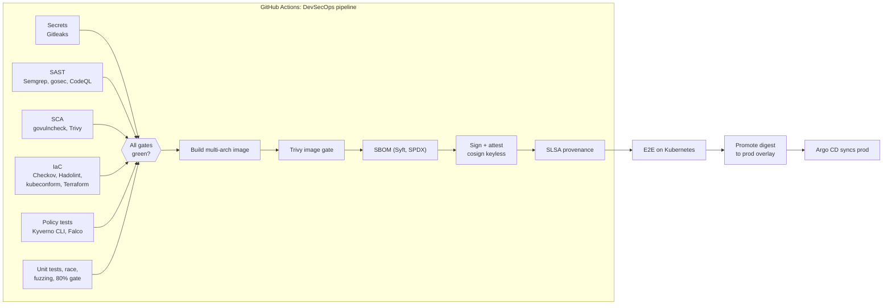
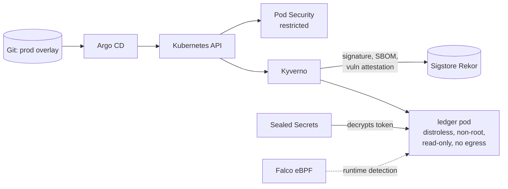

# Aegis: an end-to-end DevSecOps platform

[](https://github.com/ahmedelgmal310/aegis-devsecops/actions/workflows/devsecops.yml)
[](https://github.com/ahmedelgmal310/aegis-devsecops/actions/workflows/codeql.yml)
[](https://scorecard.dev/viewer/?uri=github.com/ahmedelgmal310/aegis-devsecops)
[](LICENSE)

Aegis secures the whole path from a `git push` to a running pod. Code is
scanned before it is built, every image is signed and carries a signed SBOM
and vulnerability report, the cluster refuses anything that cannot prove where
it came from, and Falco watches what happens after deployment.

The pipeline does not just scan. On every release it **attacks its own
cluster** and fails if any attack gets through.

## How it works





## Security controls

| Layer | Control | Tooling |
|---|---|---|
| Code | Secret scanning on the full git history | Gitleaks |
| Code | Static analysis, results in GitHub code scanning | Semgrep, gosec, CodeQL (`security-extended`) |
| Dependencies | Reachable vulnerabilities, dependency and license scan, weekly updates | govulncheck, Trivy, Dependabot |
| Infrastructure | Kubernetes, Dockerfile, Terraform and workflow misconfigurations | Checkov, Hadolint, kubeconform, actionlint |
| Policy | Admission policies unit-tested like code | Kyverno CLI, `falco -V` |
| Build | Distroless, non-root, multi-arch image; build fails on fixable HIGH/CRITICAL CVEs | Docker Buildx, Trivy |
| Supply chain | Keyless signature, signed SPDX SBOM, signed vulnerability report, SLSA provenance | cosign, Syft, Sigstore, GitHub attestations |
| Admission | Only images signed by this pipeline on `main`, with an SBOM and no CRITICAL CVEs, may run | Kyverno `ImageValidatingPolicy` |
| Admission | Trusted registry only, digest pinning, read-only rootfs, limits, no API token, no debug containers | Kyverno `ValidatingPolicy` |
| Workload | Pod Security `restricted`, seccomp, all capabilities dropped, UID 65532 | Kubernetes PSA |
| Network | Default deny, the ledger has zero egress | NetworkPolicy |
| Secrets | Encrypted in git, decrypted only inside the cluster, mounted as a file | Sealed Secrets (bring-your-own key) |
| Delivery | Git is the source of truth, drift is reverted automatically | Argo CD (self-heal, prune) |
| Runtime | Shells, discovery tools and credential reads are detected | Falco (modern eBPF) + custom rules |
| Application | Auth, validation, rate limiting, strict headers, verified by DAST | Go, OWASP ZAP |
| Pipeline | Actions pinned to SHAs, images pinned to digests, least-privilege tokens | Scorecard, CODEOWNERS |
| Cloud | ECR with KMS and immutable tags, GitHub OIDC role, no static keys | Terraform, scanned by Checkov |

The full threat model, mapped to STRIDE and the OWASP Top 10 CI/CD Security
Risks, is in [docs/threat-model.md](docs/threat-model.md).

## The pipeline attacks its own cluster

After deploying through Argo CD, the end-to-end stage runs two attack
simulations against the live cluster.

**Admission control** ([`scripts/attack-admission.sh`](scripts/attack-admission.sh)):
an unsigned image pushed to the trusted registry, an image from Docker Hub, a
mutable tag, a privileged container, a root container, a writable filesystem,
missing limits, a mounted API token and `kubectl debug`. Each one must be
rejected, and the signed release must still be accepted.

**Runtime detection** ([`scripts/attack-runtime.sh`](scripts/attack-runtime.sh)):
acts like an attacker with code execution in a container (spawns a shell, runs
discovery tools, reads `/etc/shadow`, tries to reach the internet). Falco must
raise an alert for every step.

Then OWASP ZAP scans the running service, and only if everything passed is the
image digest promoted to the prod overlay that Argo CD deploys.

## Results from the latest release

| Stage | Result |
|---|---|
| Secret scanning | 15 commits scanned, no leaks |
| SAST | Semgrep: 111 rules, 0 findings · gosec: 0 issues · CodeQL: clean |
| SCA | govulncheck: no vulnerabilities · Trivy: 0 HIGH/CRITICAL |
| IaC | Checkov: 343 passed, 0 failed (Kubernetes, Dockerfile, Terraform, Actions) |
| Policy tests | Kyverno CLI: 20/20 · Falco rules validated |
| Unit tests | 92.9% coverage (gate 80%), race detector and fuzzing |
| Image | Distroless, amd64 + arm64, 0 vulnerabilities, 19 SBOM packages |
| Supply chain | Signature, SBOM and vulnerability attestations verified with cosign; SLSA provenance verified with `gh attestation verify` |
| Admission attacks | 9/9 blocked, signed release accepted |
| Runtime attacks | 3/3 detected by Falco |
| DAST | OWASP ZAP: 67 passed, 0 warnings, 0 failures |
| Delivery | Argo CD Synced / Healthy, digest promoted to prod |

## Run it yourself

Requirements: Docker, [kind](https://kind.sigs.k8s.io/), kubectl, Helm 4 and
about 6 GB of free memory.

```bash
git clone https://github.com/ahmedelgmal310/aegis-devsecops.git
cd aegis-devsecops
make demo      # cluster + platform, GitOps deploy, smoke test, attacks, DAST
make down      # delete the cluster
```

`make help` lists the individual steps. The committed SealedSecret can only be
decrypted with the project's private sealing key. Without it, generate your own
key pair and re-seal the token as described in [docs/runbook.md](docs/runbook.md).

### Verify a release without trusting me

```bash
IMAGE=ghcr.io/ahmedelgmal310/aegis-ledger@sha256:<digest>   # see deploy/k8s/overlays/prod
ID=https://github.com/ahmedelgmal310/aegis-devsecops/.github/workflows/devsecops.yml@refs/heads/main

cosign verify "$IMAGE" --certificate-identity "$ID" \
  --certificate-oidc-issuer https://token.actions.githubusercontent.com
cosign verify-attestation "$IMAGE" --type spdxjson --certificate-identity "$ID" \
  --certificate-oidc-issuer https://token.actions.githubusercontent.com
gh attestation verify "oci://$IMAGE" --repo ahmedelgmal310/aegis-devsecops
```

## Repository layout

```
app/                    Go service (ledger API), Dockerfile, tests, fuzz test
deploy/k8s/             Kustomize base + overlays (ci, prod)
deploy/policies/        Kyverno policies and their unit tests
deploy/falco/           Falco values and custom runtime rules
deploy/argocd/          Argo CD project and application
deploy/dast/            OWASP ZAP rule thresholds
infra/terraform/aws/    ECR, KMS and GitHub OIDC role
scripts/                Cluster bootstrap, deploy, smoke test, attack simulations, DAST
docs/                   Threat model and runbook
.github/                Pipeline, CodeQL, Scorecard, Dependabot, CODEOWNERS
```

## Tech stack

Go 1.27 · Docker Buildx · GitHub Actions · Kubernetes 1.36 (kind) · Kyverno 1.19 ·
Falco 0.45 · Argo CD 3.5 · Sealed Secrets · Sigstore cosign 3 · Syft · Trivy ·
Semgrep · CodeQL · gosec · govulncheck · Gitleaks · Checkov · Hadolint ·
OWASP ZAP · Terraform · OpenSSF Scorecard

## License

[MIT](LICENSE)
