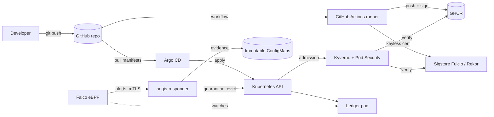

# Threat model

Aegis protects one path: **source code → container image → running pod**.
This document lists what can go wrong on that path and which control stops
it. Every control named here is implemented and exercised by the pipeline.

## Assets

| Asset | Why it matters |
|---|---|
| Source code and pipeline definitions | Whoever changes them controls what ships |
| Container image in GHCR | The artifact that actually runs |
| Signing identity (GitHub OIDC → Fulcio) | Proves an image came from this pipeline |
| Sealing key for secrets | Decrypts every secret committed to git |
| Ledger API token | Grants write access to the ledger |
| Running cluster | Production workload and its data |

## Trust boundaries

Boundaries: developer ↔ GitHub, GitHub ↔ runner, runner ↔ registry,
registry ↔ cluster, cluster API ↔ workload, workload ↔ network,
Falco ↔ responder (mutual TLS), responder ↔ cluster API (namespaced RBAC).

## Threats and controls (STRIDE)

| # | Threat | STRIDE | Control | Where |
|---|---|---|---|---|
| T1 | Secret committed to git | Information disclosure | Gitleaks on the full history; secrets only as SealedSecrets | `secrets` job, `deploy/k8s/base/sealed-secret.yaml` |
| T2 | Vulnerable code (injection, unsafe HTTP) | Tampering / Elevation | Semgrep, gosec, CodeQL `security-extended`; input validation, body limits, timeouts | `sast` job, `codeql.yml`, `app/internal` |
| T3 | Vulnerable or malicious dependency | Tampering | govulncheck (reachability), Trivy fs, license scan, Dependabot | `sca` job, `dependabot.yml` |
| T4 | Insecure infrastructure or manifests | Elevation | Checkov, Hadolint, kubeconform, Terraform validate | `iac` job |
| T5 | Image swapped or tag moved after release | Spoofing / Tampering | Digest pinning; Sigstore keyless signature bound to this workflow on `main`; Kyverno verifies at admission | `build` job, `verify-supply-chain.yaml` |
| T6 | Known-vulnerable image deployed | Elevation | Trivy gate in CI **and** signed vulnerability attestation checked by Kyverno (no CRITICAL) | `build` job, `verify-supply-chain.yaml` |
| T7 | Unknown contents shipped | Repudiation | Signed SPDX SBOM attestation; SLSA build provenance | `build` job |
| T8 | Image from an untrusted registry | Spoofing | Registry allowlist policy | `restrict-image-registries.yaml` |
| T9 | Container breakout / privilege escalation | Elevation | Pod Security `restricted`, non-root UID 65532, read-only rootfs, all capabilities dropped, seccomp, distroless image | namespace labels, `deployment.yaml`, `require-workload-hardening.yaml` |
| T10 | Stolen service-account token used against the API | Elevation | Token automount disabled and enforced by policy | `require-workload-hardening.yaml` |
| T11 | Lateral movement / data exfiltration | Information disclosure | Default-deny NetworkPolicies, zero egress for the ledger | `networkpolicy.yaml` |
| T12 | Attacker injects a debug container | Elevation | Ephemeral containers blocked | `block-ephemeral-containers.yaml` |
| T13 | Code execution inside a container | Elevation | Falco runtime rules: shell, discovery tools, credential reads | `deploy/falco/aegis-rules.yaml` |
| T14 | Manual drift in the cluster | Tampering | Argo CD auto-sync with self-heal and prune | `deploy/argocd` |
| T15 | Brute force / abuse of the API | Denial of service | Constant-time token check, per-client rate limit, bounded store | `app/internal/api` |
| T16 | Web misconfiguration (headers, CSP, clickjacking) | Tampering | Strict security headers, verified by OWASP ZAP on every release | `scripts/dast.sh` |
| T17 | Compromised pipeline (poisoned action, over-privileged token) | Tampering / Elevation | Actions pinned to commit SHAs, tool images pinned by digest, least-privilege `GITHUB_TOKEN` per job, actionlint, OpenSSF Scorecard, CODEOWNERS | `.github/` |
| T18 | Long-lived cloud credentials leaked | Spoofing | GitHub OIDC federation to AWS scoped to this repo and branch | `infra/terraform/aws/github-oidc.tf` |
| T19 | Attacker keeps working after being detected | Elevation / Information disclosure | Automated containment: the responder isolates the pod with a NetworkPolicy and detaches it from its controller within seconds; a clean replacement takes the traffic | `app/internal/responder`, `deploy/response` |
| T20 | Evidence destroyed when the pod is deleted | Repudiation | Alert, pod object and logs written to an immutable ConfigMap before termination; the responder can create but not read, edit or delete evidence | `responder.go`, `deploy/response/base/rbac.yaml` |
| T21 | Forged alerts used to make the responder kill healthy pods | Spoofing / Denial of service | Mutual TLS (only Falco's client certificate is accepted), ingress NetworkPolicy from the `falco` namespace only, namespace allowlist, container-ID check, rate limit and bounded queue | `server.go`, `deploy/response/base/networkpolicy.yaml` |
| T22 | Compromised responder abused against the cluster | Elevation | Namespaced Roles only (no ClusterRole, no Secrets, no exec), signed image verified at admission, restricted PSA, only egress is the API server; the API-token exception is tied to its service account and proven not borrowable | `rbac.yaml`, `require-workload-hardening.yaml`, `attack-admission.sh` |

## OWASP Top 10 CI/CD Security Risks

| Risk | Mitigation in Aegis |
|---|---|
| CICD-SEC-1 Insufficient flow control | All gates must pass before build; promotion only after E2E on `main`; CODEOWNERS |
| CICD-SEC-2 Inadequate identity and access management | OIDC everywhere, no static credentials, least-privilege job permissions |
| CICD-SEC-3 Dependency chain abuse | govulncheck, Trivy, Dependabot, `go mod verify` in the build |
| CICD-SEC-4 Poisoned pipeline execution | PRs build without secrets or write tokens; no `pull_request_target` |
| CICD-SEC-5 Insufficient PBAC | Per-job `permissions`, top-level `contents: read` |
| CICD-SEC-6 Insufficient credential hygiene | Gitleaks, SealedSecrets, the sealing key held only in the CI secret store |
| CICD-SEC-7 Insecure system configuration | Checkov on workflows, actionlint, Scorecard |
| CICD-SEC-8 Ungoverned 3rd-party services | Actions pinned by SHA, tool images pinned by digest, manifests checksum-verified |
| CICD-SEC-9 Improper artifact integrity validation | cosign signatures and attestations, verified again at admission |
| CICD-SEC-10 Insufficient logging and visibility | SARIF in GitHub code scanning, job summaries, Falco alerts, Kyverno policy reports, Prometheus alerts for every contained incident |

## Residual risks

- Sigstore public-good infrastructure is a dependency for admission; if Rekor
  is unreachable, new pods are rejected (fail closed by design).
- The demo cluster is single-node kind; node-level hardening (CIS benchmark,
  kernel lockdown) is out of scope.
- The Terraform module is validated and scanned in CI but is not applied,
  so no AWS account is required to run the project.
- The responder runs as a single replica; if it is down, threats are still
  detected and alerted on (`AegisResponderDown`) but not contained until it
  is back. The mTLS certificates are issued per cluster by a script; a
  production setup would use cert-manager with rotation.
- Containment relies on NetworkPolicy enforcement by the CNI. The drill proves
  it on every release by checking that the quarantined pod really loses its
  network.
